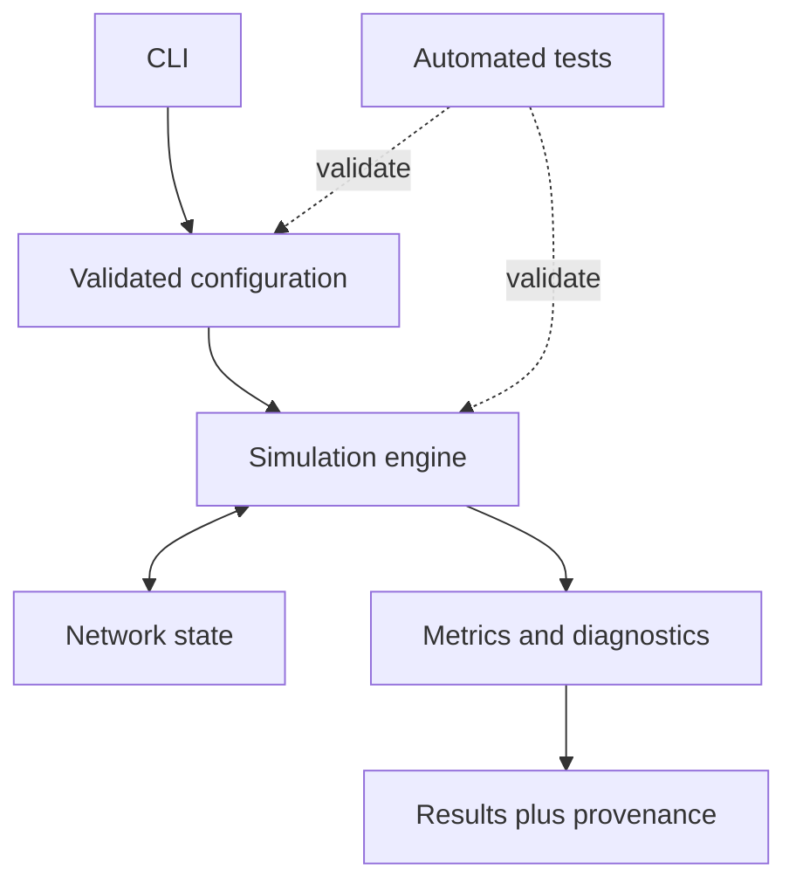

# Architecture

## Status

The repository is currently a documentation-only scaffold. This document specifies proposed boundaries, not existing implementation.

## Design goals

- Deterministic, testable simulation steps.
- Separate immutable configuration from mutable state.
- Reproducible runs with recorded seeds and model versions.
- Traceable experiment metadata and explicit model limitations.
- Synthetic data by default; no personal, clinical, neural, or biometric data in version control.

## Proposed flow

### Configuration

Validate dimensions, update rules, parameter ranges, run length, and seed at the boundary. Reject non-finite parameters and unsupported modes explicitly.

### Engine and state

The engine should own update order and expose an explicit step operation. Store mutable state separately from configuration and avoid hidden global state. Identical initial state, configuration, seed, and runtime should produce equivalent results within documented numerical tolerance.

### Results

Record configuration, seed, code revision, runtime/dependency versions, step count, metrics, and limitations. Label generated values as simulations, not biological measurements.

### Error handling

Fail fast on invalid configuration, use actionable exceptions, and never silently coerce invalid values. Preserve useful diagnostic metadata without logging sensitive data.

## Non-goals

This scaffold is not a whole-brain emulation, medical device, consciousness detector, diagnostic system, or validated model of human cognition. Biological interpretations require use-case-specific validation and independent domain review.
